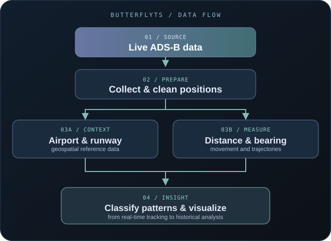
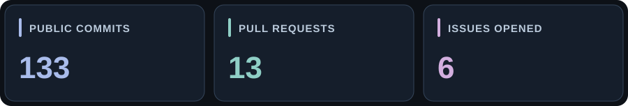

<!--
  Hi, I'm Rohan! 👋
  A quiet cyberpunk / aurora-inspired profile README.
  GitHub username: Rohan-Ktksu
  Place README.md and the assets/ folder together in your profile repository.
-->

<div align="center">


<br />

<a href="https://github.com/Rohan-Ktksu">
  
</a>

<br />

<a href="https://github.com/Rohan-Ktksu?tab=repositories"></a>
<a href="https://github.com/Rohan-Ktksu/CampusResolve-AI"></a>
<a href="https://github.com/Rohan-Ktksu/Butterflyts"></a>

</div>

<br />

### 🌙 A little about me

I'm **Rohan Sai**, a computer science student building software at the intersection of **backend engineering**, **machine learning**, **language technology**, and **real-world data**. I enjoy taking ideas from early experiments to tested, documented applications.

- ☕ Building my foundation in **Java, data structures, and backend development**
- 🐍 Building with **Python, FastAPI, React, and TypeScript** across data, APIs, and web apps
- ✈️ Working on **Butterflyts** — an aviation data and flight-pattern analysis project
- 🧠 Building **Axynetra** (explainable network-threat classification) and **ShabdAnveshi** (bilingual reverse dictionary)
- 🏫 Collaborating on **CampusResolve AI**, an AI-assisted campus issue-resolution platform
- 🌱 Deepening my skills in **Spring Boot, TypeScript, deep learning, and LLMs**
- ✨ My philosophy: *make it useful, make it understandable, then make it better*

<br />

### 🪄 Tools I work with

<div align="center">

**Languages & fundamentals**


**Development tools**


**Growing into**


<sub>Also working with: REST APIs · Pandas · NumPy · scikit-learn · data visualization · ML/NLP · GIS</sub>

</div>

<br />

### ✈️ Featured project — Butterflyts

<a href="https://github.com/Rohan-Ktksu/Butterflyts"></a>


> A hands-on project that explores the world above us through flight data — from live aircraft positions to movement patterns around airports.

<div align="center">



<sub>From live aircraft signals to runway-aware insights.</sub>

</div>

**What I'm building and exploring:**

- Live aircraft position collection using ADS-B sources
- Runway-aware mapping and flight trajectory visualization
- Distance and bearing calculations
- Flight-pattern classification and historical analysis

**Stack:** `Python` · `Pandas` · `NumPy` · `Matplotlib` · `Parquet` · `Git`

<br />

### 🌌 Selected projects

Selected public work, from research prototypes to deployed applications:

| Project | What it does | Stack |
|:--|:--|:--|
| [**CampusResolve AI**](https://github.com/Rohan-Ktksu/CampusResolve-AI) · [Live demo](https://campusresolve-ai-sigma.vercel.app/app) | Team-built campus issue reporting, routing, analytics and local NLP-assisted triage | React · FastAPI · PostgreSQL · NLTK |
| [**Axynetra**](https://github.com/Rohan-Ktksu/axynetra) | Explainable multi-class network traffic classification and alert triage; includes notebooks and a dashboard | Python · scikit-learn · Streamlit |
| [**ShabdAnveshi**](https://github.com/Rohan-Ktksu/shabdanveshi) · [Live site](https://rohan-ktksu.github.io/shabdanveshi/) | English/Hindi reverse dictionary using semantic retrieval and translation | React · TypeScript · FastAPI · NLP |
| [**CampusResolve AI**](https://github.com/Rohan-Ktksu/CampusResolve-AI) | Campus issue management prototype with local NLP triage, reports, and resolution analytics ([demo](https://campusresolve-ai-sigma.vercel.app/app)) | React · FastAPI · PostgreSQL |
| [**Axynetra**](https://github.com/Rohan-Ktksu/axynetra) | Explainable multi-class network threat classification and alert-triage research; distinguishes synthetic demonstrations from sampled UNSW-NB15 results | Python · scikit-learn · Streamlit |
| [**ShabdAnveshi**](https://github.com/Rohan-Ktksu/shabdanveshi) | Bilingual English/Hindi reverse dictionary ([try it](https://rohan-ktksu.github.io/shabdanveshi/)) | React · TypeScript · FastAPI · NLP |
| [**Bengaluru Heat Atlas**](https://github.com/Rohan-Ktksu/bengaluru-heat-atlas) | Satellite-derived land-surface heat research, hotspot clustering, and an [interactive atlas](https://rohan-ktksu.github.io/bengaluru-heat-atlas/) | Python · Geospatial · Web |
| [**Michigan Powercut Model**](https://github.com/Rohan-Ktksu/michigan-powercut-model) | Historical, county-level short-horizon high-outage-burden research (not a live forecast) | Python · Machine learning |
| [**SelahFrame**](https://github.com/Rohan-Ktksu/selahframe) | Local Windows scripture-video creation studio with approved narration, captions, and export tracking | Python · FFmpeg · SQLite |
| [**Careva**](https://github.com/Rohan-Ktksu/careva_website) | Student career-guidance web application with learning roadmaps and coaching features | React · Flask |
| [**Personal Portfolio**](https://github.com/Rohan-Ktksu/rohan-sai-portfolio) | My [portfolio website](https://rohan-ktksu.github.io/rohan-sai-portfolio/), projects, and learning journey | HTML · CSS · TypeScript |

<div align="center">

<a href="https://github.com/Rohan-Ktksu?tab=repositories"></a>

</div>

<br />

### 🧩 DSA — getting a little better every day

I practice problem-solving in **Java**, focusing on understanding *why* an algorithm works, not just getting the accepted answer. I work through LeetCode patterns and HackerRank challenges, especially arrays, strings, and linked lists.

<div align="center">

<a href="https://leetcode.com/u/rohansaigorumutchu/"></a>
<a href="https://www.hackerrank.com/profile/h24020301819"></a>

</div>

| Foundations | Problem-solving patterns | Next horizons |
|:--|:--|:--|
| Arrays & strings | Two pointers | Trees & graphs |
| Linked lists | Sliding window | Dynamic programming |
| Stacks & queues | Binary search | Backtracking |

<sub>📍 My approach: understand → implement → test edge cases → optimize → explain.</sub>

<br />

### 📈 GitHub activity and contributions

<div align="center">



<sub>Public, searchable activity across GitHub. Counts are generated from GitHub Search and can differ from the contribution graph (which has separate attribution and private-activity rules). The graphic updates daily when GitHub Actions runs successfully.</sub>

<br />

<a href="https://github.com/search?q=author%3ARohan-Ktksu&type=commits">Commits</a> ·
<a href="https://github.com/pulls/Rohan-Ktksu">Pull requests</a> ·
<a href="https://github.com/issues/created_by/Rohan-Ktksu">Issues</a> ·
<a href="https://github.com/Rohan-Ktksu?tab=overview">Contribution graph</a>

<br />


</div>

<br />

### 🧭 What I'm focusing on

```text
01  Deepen Java + Spring Boot fundamentals
02  Keep practicing DSA consistently
03  Grow Butterflyts and my data research work
04  Explore ML, NLP, and practical LLM engineering
05  Ship, test, and document useful applications
```

<br />

<div align="center">


<sub>Thanks for stopping by — feel free to explore my repositories ✨</sub>

</div>
