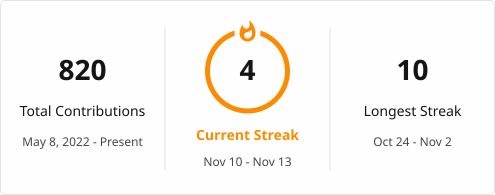

# Hi, I'm Rohan Sai 👋

I'm a computer science student building web applications, backend systems, and applied machine learning projects. I enjoy making complex ideas useful and easy to understand.

**Explore:** [Projects](#projects) · [Tools](#tools-i-work-with) · [Connect](#connect)

## Projects

- **[Bolmava](https://github.com/Rohan-Ktksu/bolmava)** — a B2B commerce prototype for Indian buyers and sellers, with English/Telugu screens and simulated transactions.
- **[Butterflyts](https://github.com/Rohan-Ktksu/Butterflyts)** — aviation data collection and flight-pattern analysis.
- **[CampusResolve AI](https://github.com/Rohan-Ktksu/CampusResolve-AI)** — a team-built campus issue reporting and triage app. [Try the demo](https://campusresolve-ai-sigma.vercel.app/app).
- **[ShabdAnveshi](https://github.com/Rohan-Ktksu/shabdanveshi)** — an English/Hindi reverse dictionary. [Visit the site](https://rohan-ktksu.github.io/shabdanveshi/).
- **[Axynetra](https://github.com/Rohan-Ktksu/axynetra)** — explainable network-traffic classification research.

[See all my repositories](https://github.com/Rohan-Ktksu?tab=repositories)

## Tools I work with

**Languages**

**Web, APIs and data**

**Development tools**

**Learning:** Spring Boot · PyTorch · practical LLM engineering

**Kaggle milestones**

## Connect

